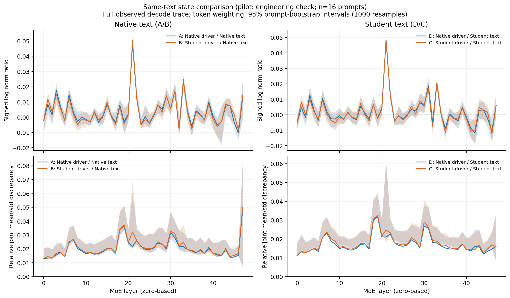
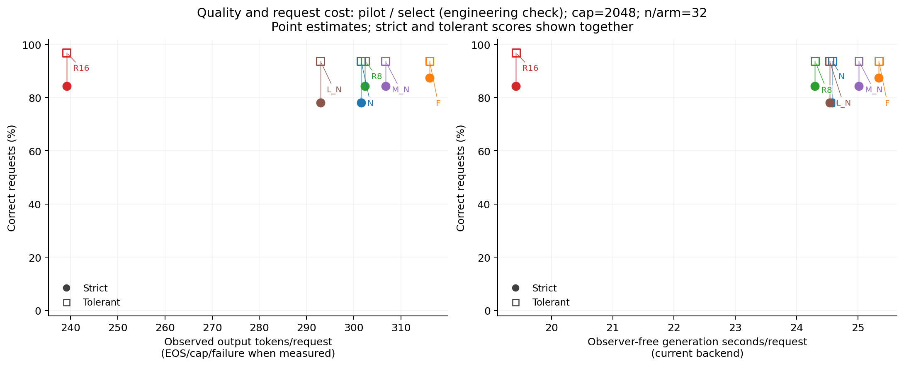

# MoE 状态来源校准：阶段进度与已完成结果

更新时间：2026-10-19T16:38:38-04:00（EDT）。这是进度快照，正式结果尚未齐备。

研究对象是 Qwen3-30B-A3B-Instruct-2507（BF16）。所有方法 prefill 保持原生8专家，decode 比较原生8专家与4专家的 reference/归一化/聚合校准策略。GSM8K 是检验这些 MoE 干预的数据。

## 当前完成到哪里

- P0：真实BF16正确性预检52/52通过；冻结core的78项CPU检查通过。
- smoke和16/16/32工程pilot全链路完成。
- 正式C_fit128完成：30788生成token、每层30660有效decode位置，两种参数及六臂实际参数预检通过。
- 正式D_select：N 131/256；F 128/256；R8 128/256；R16 128/256；M_N 128/256；L_N 128/256。每臂固定256题。
- 另128题正式C_diag四路径诊断、条件触发的一次重校准和512题冻结后复核仍待运行；完整任务尚未完成。
- quality计划当前为前瞻草案，待正式选择完成后、任何验证数据产生前冻结。

## 已完成的32题工程pilot

这部分使用16题拟合的pilot参数，正式阶段已在128题重新拟合并产生不同hash。以下仅是pilot描述结果，不与正式数据合并，不用于宣布方法胜出。Strict与tolerant是两个冻结解析口径，后者不能直接等同真实答题能力。

| 方法 | Strict正确/32 | Tolerant正确/32 | 平均生成token | 自然EOS/32 | 行政截断/32 |
|---|---:|---:|---:|---:|---:|
| N | 25 | 30 | 301.56 | 31 | 1 |
| F | 28 | 30 | 316.06 | 31 | 1 |
| R8 | 27 | 30 | 302.41 | 31 | 1 |
| R16 | 27 | 31 | 239.19 | 32 | 0 |
| M_N | 27 | 30 | 306.72 | 31 | 1 |
| L_N | 25 | 30 | 292.94 | 31 | 1 |

N=原生K8；F=K4 full renorm；R8=K4 native reference；R16=K4 reference16（实际只计算4个专家FFN）；M_N=原生状态scalar；L_N=原生状态LDA。

初步观察：R16在这个小样本上的已观察输出更短，两个解析口径的正确题数见表。所有方法cap=2048，截断样本保留；不能把小样本描述视为质量保持、显著胜出或未知长尾长度的结论。

## 已完成的16题工程状态诊断

固定pilot L_N，用A/B/C/D四路径分开文本来源和执行策略；主指标为全轨迹、token加权E_moment。保存的1000次配对prompt bootstrap结果如下，未为本次发布重算。

| 受控比较 | 估计 | 95% percentile CI |
|---|---:|---:|
| C_minus_D | 0.00063879 | [-0.00023611, 0.00099727] |
| B_minus_A | 0.00069176 | [-0.00016513, 0.00084427] |

C−D是在相同student文本上仅改变内部执行策略；B−A是在相同native文本上的支持性对照。pilot保存的工程标签为NEGATIVE，重新校准门槛未触发。这不构成正式P3负结果，不决定正式P4；正式128题诊断仍待完成。不能用区间跨0单独证明等价，也不能把固定参数bootstrap说成包含重拟合不确定性。





## 可核验来源与后续工作

- [结构化数值和原始记录hash](state_study_progress.json)
- [冻结32份科学来源](evidence/frozen_scientific_sources.json)、[证据文件清单](evidence/evidence_manifest.json)
- [真实BF16预检审计及原报告hash](evidence/bf16_preflight_audit.json)、[正式校准验收](evidence/formal_calibration_complete_audit.json)
- [完整执行计划](state_calibration_execution_plan.md)、[调度与接续说明](state_slurm_resume.md)

下一步是完成六臂各256题正式选择，再执行正式128题状态诊断，按固定证据门槛决定后续重校准与512题复核。P6/P7及校准抽样稳定性仍依原计划证据链条件执行。最终九问结论报告尚未交付。

当前进程存活时只读查看进度，避免重复启动：

```sh
cat /scratch/jgu7/moe-state-study/runs/20261019_bf16_eager_v4/STATUS.md
```

原始数据、参数和充分统计保存在服务器 `/scratch/jgu7/moe-state-study/runs/20261019_bf16_eager_v4`；GitHub保存代码、小型证据、图和进度快照。模型、数据集、环境和大体积原始产物保存在Scratch。

验证范围：core78项与P0 52项属于冻结测量版本；另附最新ops CLI2修复68项针对性证据，不把不同版本/重叠套件相加成总测试数。
